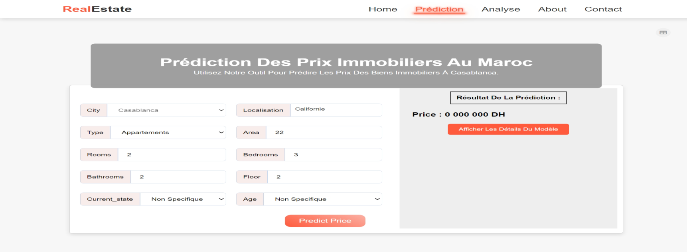

# Prédiction et analyse des prix immobiliers au Maroc

Application web de prédiction de prix immobiliers, associée à une analyse exploratoire des annonces et à la comparaison de modèles de régression. Le projet relie la préparation des données dans des notebooks Jupyter à une interface Flask utilisant un modèle **Random Forest Regressor**.

**Périmètre des données : Casablanca · Devise : dirham marocain (MAD / DH) · Surface : m²**


## Sommaire

- [Présentation](#présentation)
- [Fonctionnalités et interfaces](#fonctionnalités-et-interfaces)
- [Technologies](#technologies)
- [Données](#données)
- [Démarche de modélisation](#démarche-de-modélisation)
- [Organisation du dépôt](#organisation-du-dépôt)
- [Installation et démarrage](#installation-et-démarrage)
- [Routes de l’application](#routes-de-lapplication)
- [État technique et améliorations](#état-technique-et-améliorations)

## Présentation

Réalisé dans le cadre d’un stage technique chez **TECH-57**, en filière **Informatique Décisionnelle et Statistiques** à l’**École Supérieure de Technologie de Fkih Ben Salah**, ce projet vise à :

- explorer les relations entre les prix et les caractéristiques des biens ;
- comparer plusieurs méthodes de régression ;
- proposer une interface de saisie pour estimer le prix d’un bien ;
- présenter les distributions de prix et les différences entre quartiers et types de biens.

Le titre décrit l’ambition du projet à l’échelle du Maroc. Les trois fichiers de données présents dans le dépôt concernent Casablanca ; l’application ne dispose pas de données permettant de valider une généralisation aux autres villes.

## Fonctionnalités et interfaces

Les deux captures présentées ici sont extraites du rapport de stage : figures 4 et 5, pages 17 et 18. Elles illustrent la version présentée dans le rapport ; la disposition de certains éléments diffère des templates actuels.

### Accueil

Présentation du projet, navigation vers les pages de l’application et accès au formulaire de prédiction. La capture d’accueil figure en tête de ce document.

### Prédiction

Formulaire de description d’un bien, zone d’affichage du prix estimé en DH, détails du modèle et tableau d’exemples d’annonces. Le tableau est alimenté par quatre exemples écrits dans le template.



### À propos

Présentation du projet et de son équipe dans `templates/about.html`. Aucune capture dédiée à cette page n’apparaît dans la section des interfaces du rapport.

## Technologies

| Composant | Technologies présentes dans le dépôt |
| --- | --- |
| Application web | Python, Flask, templates HTML |
| Interface | CSS, JavaScript, Tom Select, Font Awesome |
| Manipulation des données | pandas, NumPy |
| Modélisation | scikit-learn, XGBoost dans les notebooks |
| Visualisation | Matplotlib, Seaborn, Plotly ; intégration Power BI dans la page Analyse |
| Persistance des messages | MySQL, connecteur Python |
| Expérimentation | Jupyter Notebook |
| Sérialisation du modèle | pickle |

Le rapport décrit un déploiement sur PythonAnywhere. Le dépôt ne fournit pas de configuration de déploiement ni d’adresse de démonstration vérifiable à partir de ses fichiers.

## Données

Le rapport décrit une collecte par web scraping. Le fichier brut porte le nom de Mubawab ; le script de collecte et la date exacte de collecte ne sont pas inclus dans le dépôt.

| Fichier | Rôle | Lignes | Colonnes |
| --- | --- | ---: | ---: |
| `data/mubawab_listings_casablanca.csv` | Annonces brutes et caractéristiques dans les tags | 3 300 | 7 |
| `data/data_clean.csv` | Données nettoyées et caractéristiques extraites | 1 771 | 13 |
| `data/final_data.csv` | Données finales chargées par l’application | 1 766 | 11 |

Le fichier final contient **1 358 appartements, 368 villas, 37 maisons et 3 riads**. Toutes ses lignes portent la ville `Casablanca`.

### Variables utilisées

La cible est `Price`, le prix annoncé en dirhams. Le serveur transmet au modèle les dix variables suivantes, dans cet ordre :

| Variable | Signification |
| --- | --- |
| `Type` | Type de bien |
| `Localisation` | Quartier du bien |
| `City` | Ville |
| `Area` | Surface en m² |
| `Rooms` | Nombre de pièces |
| `Bedrooms` | Nombre de chambres |
| `Bathrooms` | Nombre de salles de bains |
| `Floor` | Étage |
| `Current_state` | État du bien |
| `Age` | Tranche d’ancienneté |

Les prix proviennent d’annonces. L’évaluation porte donc sur ces données et ne mesure pas directement l’écart aux prix de transaction.

## Démarche de modélisation

Le notebook principal, `notebook/notebook.ipynb`, rassemble les étapes de préparation et de modélisation : extraction des caractéristiques depuis les tags, nettoyage, traitement des valeurs manquantes, encodage des catégories avec `LabelEncoder`, standardisation avec `StandardScaler`, séparation des données et comparaison de régressions.

Les expériences comprennent la régression linéaire, Ridge, Lasso, un arbre de décision, Random Forest, KNN, XGBoost et RANSAC. Le notebook `notebook/analyse.ipynb` rassemble des analyses et visualisations complémentaires.

### Modèle chargé par l’application

- `models/random_forest_model.pkl` : modèle de régression sérialisé.
- `models/label_encoders_and_scaler.pkl` : encodeurs de catégories et scaler.
- Métadonnées de sérialisation des deux fichiers : **scikit-learn `1.4.1.post1`**.

Au démarrage, Flask charge ces deux fichiers et `data/final_data.csv`. Lors d’une requête de prédiction, le serveur construit un DataFrame à partir du formulaire, lui ajoute dix lignes tirées au hasard du jeu final, applique le prétraitement puis renvoie la première prédiction.

### Résultats enregistrés

Les sorties sauvegardées du notebook principal contiennent notamment :

| Expérience Random Forest | R² d’entraînement | R² de test |
| --- | ---: | ---: |
| 200 arbres, séparation de test à 20 %, graine de séparation non fixée | 0,968 | 0,758 |
| 200 arbres, séparation de test à 20 %, `random_state=33` pour la séparation | 0,966 | 0,829 |

Ces chiffres proviennent des sorties enregistrées, sans réexécution. Les cellules modifient plusieurs fois les jeux de données et les modèles ; ces résultats ne constituent pas une évaluation identifiée du fichier `.pkl` distribué.

La valeur **90 %** visible dans l’interface est définie dans le code et le template. Elle n’est pas calculée lors d’une prédiction. Le R² évalue un modèle sur un ensemble de données ; il ne représente pas une probabilité de justesse pour un bien individuel.

## Organisation du dépôt

```text
Prediction-des-Prix-Immobiliers-au-Maroc/
├── app.py
├── requirements.txt
├── README.md
├── data/
│   ├── mubawab_listings_casablanca.csv
│   ├── data_clean.csv
│   └── final_data.csv
├── docs/
│   └── interfaces/
│       ├── accueil.png
│       ├── prediction.png
│       ├── analyse.png
│       └── contact.png
├── models/
│   ├── random_forest_model.pkl
│   └── label_encoders_and_scaler.pkl
├── notebook/
│   ├── notebook.ipynb
│   └── analyse.ipynb
├── static/
│   ├── imgs/
│   ├── main.js
│   └── fichiers CSS
└── templates/
    ├── home.html
    ├── predict.html
    ├── analyse.html
    ├── about.html
    └── contact.html
```

## Installation et démarrage

### 1. Récupérer le projet

```bash
git clone https://github.com/mohamed-maiski/Prediction-des-Prix-Immobiliers-au-Maroc.git
cd Prediction-des-Prix-Immobiliers-au-Maroc
```

### 2. Créer un environnement Python

Les notebooks indiquent Python **3.11.3**. Utiliser Python **3.11** pour se rapprocher de cet environnement.

```bash
python -m venv .venv
```

Activation sous Windows PowerShell :

```powershell
.\.venv\Scripts\Activate.ps1
```

Activation sous Linux ou macOS :

```bash
source .venv/bin/activate
```

### 3. Installer les bibliothèques de l’application

Le fichier `requirements.txt` actuel omet scikit-learn et référence des paquets MySQL historiques. Pour préparer les dépendances directement utilisées par `app.py` :

```bash
python -m pip install numpy==1.24.3 pandas==2.0.3 Flask==2.3.2 scikit-learn==1.4.1.post1 mysql-connector-python
```

Cette commande reprend les versions NumPy, pandas et Flask du dépôt, ainsi que la version scikit-learn des fichiers sérialisés. L’installation complète dans un environnement vierge et la compatibilité du connecteur MySQL restent à valider.

Pour explorer les notebooks, ajouter les bibliothèques utilisées par leurs cellules :

```bash
python -m pip install jupyter matplotlib seaborn scipy plotly xgboost imbalanced-learn geopy folium
```

Les versions de ces dépendances d’exploration ne sont pas figées. Les notebooks contiennent des chemins locaux et des cellules expérimentales à adapter avant une exécution intégrale.

### 4. Préparer MySQL pour les messages de contact

MySQL intervient lors de l’envoi d’un message ; les autres pages et le chargement du modèle ne nécessitent pas de connexion à la base.

La fonction `SendContact()` dans `app.py` utilise actuellement :

| Paramètre | Valeur dans le code |
| --- | --- |
| Hôte | `localhost` |
| Base | `stage` |
| Utilisateur | `root` |
| Mot de passe | Chaîne vide |

Adapter ces paramètres à l’instance locale. Le schéma minimal ci-dessous correspond aux colonnes de la requête d’insertion ; aucun script SQL n’est fourni dans le dépôt.

```sql
CREATE DATABASE IF NOT EXISTS stage
  CHARACTER SET utf8mb4 COLLATE utf8mb4_unicode_ci;

USE stage;

CREATE TABLE IF NOT EXISTS contact (
    id INT UNSIGNED AUTO_INCREMENT PRIMARY KEY,
    nom VARCHAR(100) NOT NULL,
    prenom VARCHAR(100) NOT NULL,
    email VARCHAR(255) NOT NULL,
    object VARCHAR(255) NOT NULL,
    message TEXT NOT NULL
);
```

### 5. Démarrer Flask

Exécuter depuis la racine du dépôt, car les chemins du modèle et du CSV sont relatifs au répertoire courant :

```bash
python app.py
```

Ouvrir [http://127.0.0.1:5000](http://127.0.0.1:5000). Le serveur est configuré sur `0.0.0.0:5000`, avec le mode debug désactivé.

## Routes de l’application

| Méthode | Route | Rôle |
| --- | --- | --- |
| GET | `/` | Accueil |
| GET | `/Prediction` | Formulaire de prédiction ; majuscule initiale requise |
| GET | `/analyse` | Graphiques et intégration Power BI |
| GET | `/about` | Présentation du projet |
| GET | `/contact` | Formulaire de contact |
| POST | `/predict` | Estimation à partir des dix caractéristiques du bien |
| POST | `/SendContact` | Enregistrement d’un message dans MySQL |

`/predict` lit des champs de formulaire et renvoie un texte JSON contenant `prediction` et `score`, ou `error`. `/SendContact` attend `nom`, `prenom`, `Email`, `Object` et `Message`, puis renvoie `Contact` ou `error`. Les réponses sont actuellement construites avec `json.dumps`, sans gestion explicite des codes HTTP d’erreur.

## État technique et améliorations

L’examen du code et des notebooks fait ressortir les points suivants, à traiter pour fiabiliser le parcours de prédiction et rendre les résultats reproductibles.

| Priorité | Constat dans le dépôt | Amélioration à réaliser |
| --- | --- | --- |
| 1 | Les encodeurs sont réajustés sur la saisie et dix annonces aléatoires à chaque requête ; les objets partagés sont modifiés | Conserver les catégories apprises à l’entraînement, utiliser uniquement `transform` et définir le traitement des catégories inconnues |
| 1 | Le champ `City` est désactivé et n’est pas transmis ; le sélecteur de quartier n’a pas de `name` | Envoyer explicitement `City=Casablanca` et `Localisation`, puis valider leur présence côté serveur |
| 1 | `Floor` est désactivé pour les biens autres que les appartements ; le serveur appelle pourtant `float()` sur sa valeur | Transmettre une valeur explicite ou appliquer une valeur par défaut validée côté serveur |
| 1 | Le formulaire utilise `maisons` alors que les données contiennent `Maisons`, et certains quartiers ont des espaces finaux | Harmoniser les catégories entre formulaire, données et encodeurs |
| 1 | Le prétraitement est ajusté avant la séparation entraînement/test ; `rf` est ensuite réentraîné sur toutes les données avant son export | Séparer les données avant tout ajustement et exporter un pipeline associé à ses métriques et à sa configuration |
| 1 | Le score présenté dans l’interface est fixe | Afficher uniquement des métriques issues d’une évaluation indépendante et documentée |
| 2 | Les champs numériques et les catégories sont peu contrôlés côté serveur | Valider les types, les bornes et les valeurs autorisées ; renvoyer des erreurs explicites |
| 2 | La page Contact charge le gestionnaire partagé qui soumet les formulaires à `/predict`, en plus de son gestionnaire `/SendContact` | Limiter chaque gestionnaire au formulaire concerné et traiter les erreurs dans l’interface |
| 2 | La fermeture MySQL peut accéder à `connection` avant son initialisation si la connexion échoue | Initialiser les ressources et conditionner leur fermeture ; externaliser la configuration |
| 2 | Les dépendances ne décrivent pas un environnement complet et reproductible | Compléter les fichiers de dépendances, séparer application et exploration, puis vérifier une installation vierge |
| 3 | La page Analyse contient un texte sur Paris et une iframe intitulée `HR Dashboard` | Remplacer les contenus provisoires et vérifier la correspondance du rapport intégré avec les données immobilières |
| 3 | Aucun test automatisé ni procédure d’entraînement autonome ne figure dans le dépôt | Ajouter des vérifications du formulaire, de la stabilité des prédictions et des échecs MySQL ; formaliser l’entraînement |

Les captures du rapport documentent l’interface présentée durant le stage. Les points ci-dessus décrivent l’état du code actuel et les travaux nécessaires pour consolider l’application.
